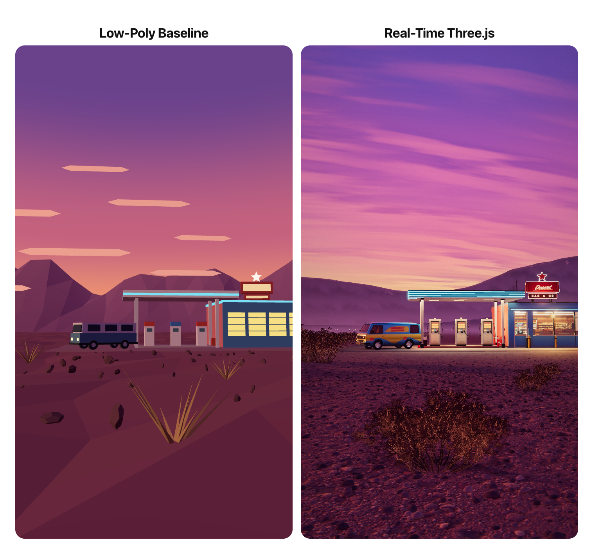
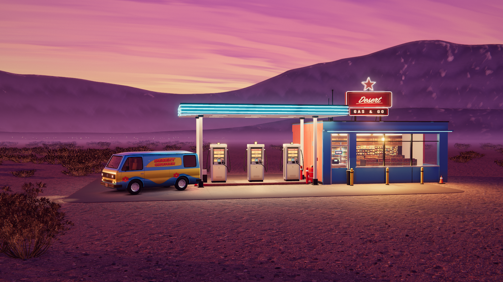
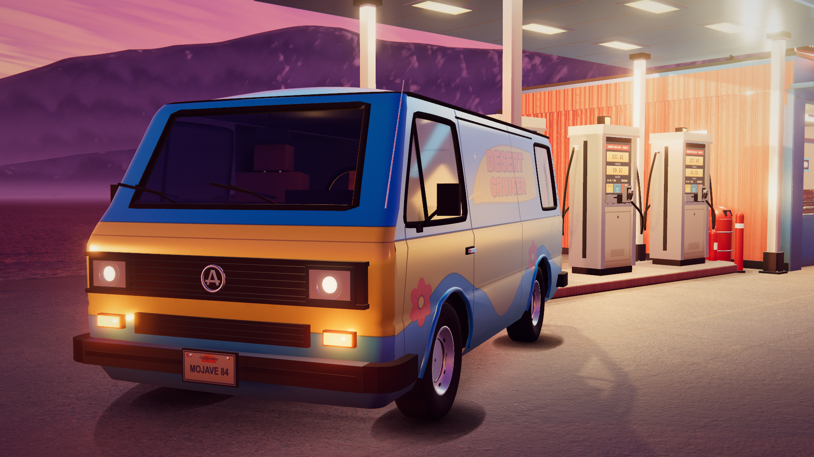
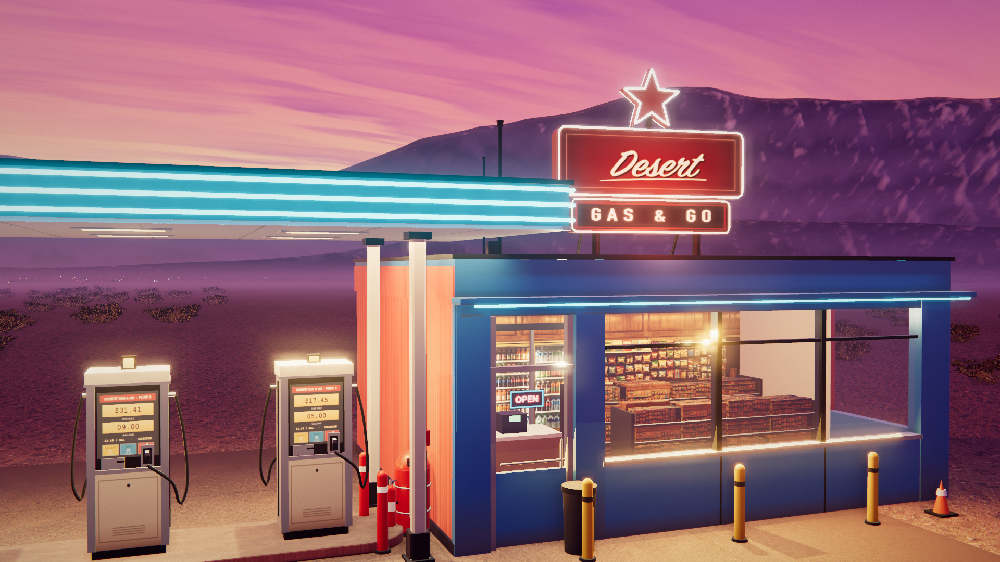

# Twilight Mojave 3D — Real-Time Three.js Showcase

**[Live Interactive Demo on Firebase Hosting -> https://twilight-mojave-3d.web.app](https://twilight-mojave-3d.web.app)**

A real-time WebGL2 / Three.js recreation of the viral Mojave desert twilight gas station & retro VW T3 camper comparison clip (`tFeMuURbfQRLZsSf.mp4`) — built for real in interactive 3D with zero pre-rendered video tricks, razor-sharp neon signage (`Desert / GAS & GO`), physical multi-source twilight lighting & shadows, photographic PBR textures, a studio lo-fi Rhodes soundtrack, and a **live synchronized Split-Screen Benchmark Mode** where dragging the mouse orbits both the Low-Poly baseline and Photorealistic worlds simultaneously.





---

## Interactive Controls

| Input | Action |
| :--- | :--- |
| **Mouse Drag / Scroll** | Free interactive orbit & dolly (works live in both Fullscreen and Split-Screen modes!) |
| **`C`** | Toggle **Split-Screen Benchmark Mode** (Low-Poly Baseline vs. Real-Time Photoreal Three.js) |
| **`Space`** | Pause / resume the 11-second cinematic leftward parallax camera sweep |
| **`L`** | Toggle **Living World** subtle motion (creosote wind sway, drifting cirrus clouds, distant horizon shimmer, neon micro-flicker) |
| **`M`** | Toggle **Lyria 3.5 Lo-Fi Twilight Soundtrack** (`~82 BPM` seamless loop with procedural Web Audio fallback) |
| **`1` – `5`** | Switch camera presets (`1` Hero 9:16 Portrait, `2` Widescreen Cinema, `3` VW T3 Van Close-Up, `4` Neon Sign & Store Close-Up, `5` Low-Angle Pebbles & Shadows) |

---

## Visual Highlights & Media Pack (`misc/`)

| Van Close-Up | Neon Sign & 3D Storefront Interior |
| :---: | :---: |
|  |  |

- **Showcase Reels (H.264 + AAC Lo-Fi Audio)**:
  - [`misc/showcase.mp4`](misc/showcase.mp4) — 19.2s multi-view cinematic camera showcase with soundtrack
  - [`misc/split_screen_comparison.mp4`](misc/split_screen_comparison.mp4) — 11.0s synchronized Low-Poly vs. Photoreal parallax comparison with soundtrack
- **Additional Stills**:
  - [`misc/hero_portrait_9x16.png`](misc/hero_portrait_9x16.png)
  - [`misc/closeup_ground_shadows.png`](misc/closeup_ground_shadows.png)

---

## How It Was Built (Gemini API Pipeline)

1. **Agentic Video Understanding (`gemini-4-hydrogen`)**: Analyzed [`tFeMuURbfQRLZsSf.mp4`](tFeMuURbfQRLZsSf.mp4) to extract exact camera parallax motion, spatial proportions, lighting color chemistry, audio tempo (~82 BPM), and reference forensics ([`agentic_video_analysis.md`](agentic_video_analysis.md), [`SCENE_SPEC.md`](SCENE_SPEC.md)).
2. **Gemini API PBR & Audio Asset Forge (`scripts/generate_assets.py`)**:
   - Generated lighting-neutral photographic textures with **`gemini-nano-banana-2.1`**, then post-processed them in Python (2-band Laplacian organic seamless blending, FFT phase-locked vertical corrugation tiling, multi-scale periodic Scharr tangent-space normal maps, calibrated roughness maps, and isolated storefront emissive maps) into `public/textures/`.
   - Generated the nostalgic ~82 BPM Rhodes / sub-bass / muted-drum twilight track with **`lyria-3.5`**, beat/chord-locked into a compact 23.39s seamless loop (`public/audio/twilight_lofi.mp3`).
3. **Real-Time WebGL2 / Three.js Architecture (`src/`)**:
   - **World (`src/world/`)**: Custom GLSL backlit twilight sky dome & `PMREMGenerator` IBL reflections, low-slung eroded Mojave ridges with aerial rose-violet valley haze & distant highway lights, displaced desert hardpan + concrete forecourt apron, 34,000 smooth GPU-instanced Mojave pebbles with shadows, and recursive 3D branching creosote/sagebrush scrub.
   - **Hero Vehicle (`src/van/`)**: Contoured 1980s VW T3 Vanagon facing left with clearcoat `DESERT CRUISER` livery, sky-reflecting tinted glass over a 3D cabin interior, shadow-casting raking halogen `SpotLight`s + volumetric haze cones, and grounded tires.
   - **Gas Station (`src/station/`)**: Dual-tube electric-cyan neon canopy with `RectAreaLight` + shadow-casting tungsten pools, 3 detailed fuel dispensers with hoses & `$3.49 / GAL` displays, corrugated salmon-pink metal siding, deep 3D lit convenience store interior behind reflective glass, and crisp rooftop **`Desert / GAS & GO`** neon marquee + 5-point star.
   - **Post-Processing (`src/postfx.js`)**: HalfFloat multisampled HDR pipeline with `GTAOPass` contact ambient occlusion, selective `UnrealBloomPass`, ACES Filmic tone mapping, and subtle 35mm twilight vignette/grain.
4. **4-Round Automated Gemini Vision Critique Loop**: Verified in headless WebGL2 across 8 views per round with **`gemini-4-hydrogen`** visual scoring (`4.5 -> 5.6 -> 7.7 -> 9.0 / 10`, zero console errors, zero 404s).

---

## Local Development

```bash
npm install
npm run dev      # Start Vite dev server at http://localhost:5173
npm run build    # Production bundle into dist/
```

To regenerate all PBR textures and the lo-fi audio loop via `gemini-api`:

```bash
python3 scripts/generate_assets.py
```
